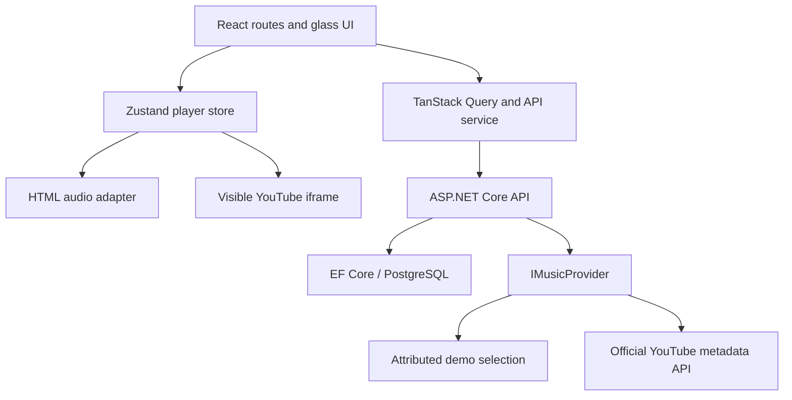

# Auralis architecture

## Boundaries

The browser owns presentation, playback adapters and queue state. ASP.NET owns authenticated user data and external metadata requests. PostgreSQL stores accounts, refresh tokens, playlists and library/history records. Third-party media is played by the authorized browser playback mechanism; the API does not extract, download or proxy YouTube audio.

## Frontend

React Router renders pages without destroying the application-wide player. Zustand carries current item, queue order, position, volume, shuffle and repeat. Playback events, rather than optimistic play-button clicks alone, should determine playing state and duration. Backend requests use a typed service and TanStack Query. Guest library data remains local; account data uses authenticated API endpoints. A refresh request is shared by concurrent failed API requests to avoid multiple rotations from one browser session.

The design uses CSS tokens, translucent panels, artwork accents and Motion transitions. Reduced-motion preferences suppress nonessential motion. Drag sorting uses dnd-kit with a stable track identity. Error UI must distinguish an unavailable upstream catalog from empty user data. The supplied demo selection is a known, attributed fallback rather than invented commercial metadata.

## Backend

`Auralis.Domain` defines persistence entities and music DTOs. `Auralis.Application` defines `IMusicProvider` and password/token helpers. `Auralis.Infrastructure` contains the EF Core model/migrations and provider implementations. `Auralis.Api` assembles dependency injection, JWT authentication, rate limits, CORS, exception responses, Swagger and routes.

Music credentials stay server-side. The provider boundary normalizes metadata but must preserve provenance: video/channel/playlist resources are not automatically equivalent to recording/artist/album entities. The default selection requires no API credentials, while YouTube search requires a configured key and available quota.

## Persistence and authentication

Passwords are stored as salted password hashes. JWT access tokens have short lifetimes; refresh tokens are represented by hashes in the database and rotate on refresh. Playlist and library operations are scoped to the authenticated user. Ordering accepts an exact track-ID permutation, preventing dropped or injected items. History carries an event ID so retries can be idempotent and seconds can be accumulated into statistics.

The initial implementation stores session tokens in browser local storage. This supports reload persistence but increases the impact of an XSS vulnerability; it is not equivalent to an HttpOnly-cookie production session design. Production hosting should review this tradeoff, enforce HTTPS and a suitable CSP, and review third-party scripts and deployment headers. Account email verification, password recovery and external identity providers are not included.

## Recommendations and statistics

Recommendations are local ranking over available catalog metadata and user preferences/history, not access to a proprietary music recommendation engine. Statistics derive from submitted listening intervals. They are informational client-reported metrics, not fraud-resistant royalty accounting. Missing genre or album metadata must remain missing or explicitly unclassified.

## Operational model

Docker Compose runs PostgreSQL only. Separate .NET and Node development processes make Windows debugging straightforward. The PowerShell helpers load local secrets explicitly. Database migrations are applied at API startup for local use. Production operators should run migrations as a controlled release step, with a backup and compatible rollout plan. Memory caching is per API process; no Redis dependency is required for this initial scale.

Frontend builds and test suites are defined in CI. A CI definition alone does not establish that it has run; consult `docs/VERIFICATION.md`. Reference-project research and provider decisions are recorded in `docs/PROVIDER_RESEARCH.md`.
